# 🤖 Awesome Conversational Business Intelligence & AI

**A curated index of enterprise SaaS platforms, autonomous analytics agents, and open-source Text-to-SQL frameworks for Conversational Business Intelligence (Conversational BI / GenBI).**

  
  
  
  
  
  

*Empowering data analysts, analytics engineers, and developers with natural language querying, governed semantic layers, automated metric insights, and self-hosted AI data agents.*

📅 **Last updated: November 2026** &bull; 🌟 **Star the repository if you find it valuable!**

---

## 📌 Table of Contents

- [🔍 Sector Overview & Market Dynamics](#-sector-overview--market-dynamics)
- [☁️ SaaS & Hosted Enterprise Platforms](#️-saas--hosted-enterprise-platforms)
- [💻 Open-Source GitHub Projects](#-open-source-github-projects)
- [📈 Star History](#-star-history)
- [🤝 How to Contribute](#-how-to-contribute)
- [💖 Support & Sponsorship](#-support--sponsorship)
- [⚠️ Disclaimer & Evaluation Guide](#️-disclaimer--evaluation-guide)

---

## 🔍 Sector Overview & Market Dynamics

The global conversational AI and business intelligence market represents an estimated addressable sector size of **~$30B to $41B in 2026**, projected to surpass **$62B+ by 2031 at a ~10–14% CAGR** as organizations transition away from static dashboards toward autonomous natural-language data agents. 

The sector currently exhibits a **moderately concentrated, barbell-fragmented structure**:
- **Hyperscalers & Warehouse Incumbents**: Major players like Microsoft (Power BI Copilot), Salesforce (Tableau Pulse / Agent), Snowflake (Cortex Analyst), and SAP (AskData) capture dominant enterprise market share by embedding NLQ natively into core data infrastructure and office suites.
- **Pure-Play Innovators & Open Ecosystems**: Specialized vendors (ThoughtSpot, Sisense, Veezoo, Luzmo) and open-source frameworks (PandasAI, Vanna, WrenAI, SQLBot) differentiate rapidly on multi-agent collaboration, dynamic knowledge graphs, air-gapped data sovereignty, and token-cost predictability.

---

## ☁️ SaaS & Hosted Enterprise Platforms

Enterprise-ready hosted solutions providing governed natural language exploration, AI copilots, and metric generation over cloud data warehouses:

| Company / Product | Company Size (Valuation / Revenue) | Starting Pricing Tier | Free Tier / Trial Limits | Key Focus & Architectural Notes |
| :--- | :--- | :--- | :--- | :--- |
| **[Power BI Copilot](https://powerbi.microsoft.com/)** 🏢 (Microsoft) | **Valuation: ~$3.1T+** *(FY25 Rev: $245B+)* | **$262.80/month** (Fabric F2 PAYG capacity) + **$14/user/month** (Power BI Pro seat below F64) | **60-day free trial** of Fabric capacity (F64 equivalent, 1 TB OneLake storage); **Note**: Copilot features require dedicated paid F2+ capacity and are excluded on trial SKUs. | Governed conversational BI deeply embedded in Microsoft Fabric / Office 365. Sustained organizational usage typically requires F64 (~$8,410/mo PAYG). |
| **[Tableau Pulse / Tableau Agent](https://www.tableau.com/)** 📊 (Salesforce) | **Valuation: ~$280B+** *(FY25 Rev: $38B+)* | **$15/user/month** (Viewer, Standard) / **$115/user/month** (Creator, Enterprise); Tableau+ bundle is custom-quoted | **60-day free trial** of Tableau Agent in Pulse on existing Tableau Cloud sites (unlimited questions during the 60-day window; cannot be extended or paused). | Conversational metric exploration and autonomous digest generation natively embedded in Tableau Cloud / Salesforce Data Cloud. |
| **[Snowflake Cortex Analyst](https://www.snowflake.com/)** ❄️ | **Valuation: ~$110B+** *(FY26 Rev: $4.68B)* | **$3.00/credit** (Enterprise Edition PAYG compute) + AI credit/message metering (~6.7 credits/100 requests) | **30-day free trial** with **$400 in platform credits**; **Note**: Cortex AI / LLM features are disabled on self-service trial accounts and require pay-as-you-go conversion. | Governed natural language to SQL executing over Snowflake warehouse tables via audited YAML semantic models. |
| **[Qlik Answers](https://www.qlik.com/)** 🔎 (Qlik / Thoma Bravo) | **Valuation: ~$10B** *(Est. ARR: $1B+)* | **$300/month** (Starter tier, billed annually at $3,600/yr for 10 users & 10 GB) or **$825/month** (Standard tier, 25 GB) | **30-day free trial** (access to full Qlik Cloud Analytics environment with standard connector limits). | Conversational analytics, unstructured content Q&A, and associative engine analysis within Qlik Cloud. |
| **[ThoughtSpot Sage](https://www.thoughtspot.com/)** 💡 | **Valuation: ~$4.2B** *(Est. ARR: ~$170M–$200M+)* | **$95/user/month** (Enterprise base seat estimate) or usage-based tiering starting ~$2,500/yr | **14-day free trial** (full access to search data, AI agents like Spotter, and warehouse connections; max 10 CSV uploads per user). | Search-driven analytics and natural language insights over cloud data warehouses using semantic search indexing. |
| **[Sisense Fusion AI](https://www.sisense.com/)** 🧩 | **Valuation: ~$1.1B** *(Est. ARR: ~$140M–$150M)* | **~$2,083/month** (Billed annually starting ~$25,000–$40,000/year base deployment package) | **14-day free trial** (cloud sandbox environment with preloaded demo datasets and Compose SDK embedding access; no credit card required). | API-first embedded conversational analytics with AI insights, ElastiCube data modeling, and custom front-end SDKs. |
| **[Domo AI](https://www.domo.com/)** 📱 | **Valuation: ~$150M** *(FY26 Rev: $318M)* | **~$2,500/month** (Billed annually starting ~$30,000/year consumption credit pool; credit charges apply to AI chat requests) | **30-day free trial** (unlimited trial credits for core BI; strictly excludes AutoML, Jupyter Workspaces, and advanced governance). | Full-stack cloud BI with conversational chat interfaces, Magic ETL pipelines, and embedded agentic workflows. |
| **[Luzmo AI](https://www.luzmo.com/)** 🚀 | **Valuation: ~$75M** *(Est. ARR: ~$5M–$10M)* | **$1,995/month** ("Embedded Everywhere" plan, billed annually; unlimited end-users, 100M Warp rows, 500 AI conversations/mo) | **10-day free trial** (full access to embedding SDKs, white-labeling, and Luzmo IQ conversational analytics; no permanent free tier). | Purpose-built embedded conversational analytics and self-service dashboards designed specifically for B2B SaaS software vendors. |
| **[AskData](https://askdata.com/)** 💼 (SAP) | **Valuation: Undisclosed** *(Parent SAP Cap: ~$260B+)* | **$4/month** (Historical standalone entry plan); integrated via SAP BTP / SAP Analytics Cloud subscription tiers | **Free-forever plan** for public datasets / SAP BTP Free Tier (evaluation access with strict capacity & service limits; 90-day integration trials). | Acquired by SAP in July 2022; conversational SQL and search-driven analytics interface embedded across SAP BTP. |
| **[Veezoo](https://www.veezoo.com/)** 🦉 | **Valuation: Undisclosed** *(Total Funding: ~$7.3M, Est. Rev: ~$1.2M)* | **$49/user/month** (Professional tier starting base) or Predictable/Flexible annual team packages (hosted LLM token costs included) | **14-day free trial** (test knowledge graph generation, root-cause analysis, and natural language queries; no permanent free tier). | AI-native conversational BI powered by dynamic knowledge graphs with all LLM token inference costs bundled into the base subscription. |

---

## 💻 Open-Source GitHub Projects

Self-hosted, transparent, and developer-friendly frameworks for building conversational BI agents, natural language querying (NLQ), and text-to-SQL pipelines. **Sorted in descending order by GitHub_Stars:**

| Open-Source Project | GitHub Stars_Badge | Core Architecture & Primary Tech Stack | Best For / Key Use Cases |
| :--- | :--- | :--- | :--- |
| **[PandasAI](https://github.com/sinaptik-ai/pandas-ai)** 🐼 |  | Python, RAG, Multi-LLM, Pandas, Polars, SQL connectors | Conversational data analysis and automated chart visualization directly over DataFrames, SQL databases, and Parquet/CSV data lakes. |
| **[Vanna.AI](https://github.com/vanna-ai/vanna)** 🐍 |  | Python, Vector Database RAG (Chroma/Pinecone/Qdrant), Multi-LLM | Accurate, self-learning Text-to-SQL generation trained on your specific schema, documentation, and historic SQL queries. |
| **[WrenAI](https://github.com/Canner/WrenAI)** 🦜 |  | TypeScript, Python, Semantic Context Engine, Multi-Engine (DuckDB, Snowflake, BigQuery) | Enterprise-grade Generative BI (GenBI) agent that translates natural language questions into trusted charts, dashboards, and verified SQL. |
| **[SQLBot](https://github.com/dataease/SQLBot)** 🤖 |  | Java, Python, RAG, Multi-database connectors | Intelligent conversational data analysis assistant and text-to-SQL question-answering system for enterprise databases. |
| **[SQLChat](https://github.com/sqlchat/sqlchat)** 💬 |  | TypeScript, Next.js, OpenAI API, MySQL, PostgreSQL, ClickHouse | Chat-based SQL web client for querying, modifying, and exploring relational and analytical databases conversationally. |
| **[SQLCoder](https://github.com/defog-ai/sqlcoder)** 🧠 |  | PyTorch, Hugging Face, StarCoder/Mistral base, Local Weights | Purpose-built open LLM weights (7B, 8B, 15B, 34B) fine-tuned specifically for high-accuracy text-to-SQL generation locally. |
| **[Awesome-Text2SQL](https://github.com/eosphoros-ai/Awesome-Text2SQL)** 📚 |  | Curated Research, LLM Benchmarks, Datasets, Evaluation Tools | Exhaustive knowledge base and academic survey of state-of-the-art LLM methods for text-to-SQL, schema linking, and data synthesis. |
| **[Conversational BI](https://github.com/The-AI-Alliance/conversational_bi)** 🌐 |  | Python, DuckDB, Semantic Mapping Layer, Open LLMs | Reference implementation from The AI Alliance illustrating governed, semantic conversational interfaces to analytical datasets. |
| **[Orion](https://github.com/gavrielhan/orion-data-analyst)** 🔭 |  | Python, LangGraph, Google BigQuery, Google Gemini API | Autonomous data analysis agent featuring statistical diagnostics, chart auto-generation, multi-step self-healing SQL, and cost limits. |

---

## 📈 Star History

---

## 🤝 How to Contribute

Contributions from data practitioners, AI researchers, and open-source maintainers are warmly welcomed! 🌟

1. 🍴 **Fork** the repository.
2. 🌿 **Create a branch** for your addition (`git checkout -b feature/add-new-bi-agent`).
3. 📝 **Add/edit entries** in `README.md` following the established table structure.
   - For SaaS tools: Include company size (valuation/revenue), starting price, and exact free tier/trial limits.
   - For Open-Source projects: Include repository link, Stars_Badge (`style=social&color=white` linking to stargazers), tech stack, and primary use cases.
4. 🚀 **Commit your changes** with a clear message and push your branch.
5. 📬 **Submit a Pull Request** with a brief rationale and verification links.

---

## 💖 Support & Sponsorship

If you find this curated collection useful for your research, team, or production architecture, consider supporting this project! Your encouragement helps keep the benchmarks, vendor pricing, and open-source landscape continuously refreshed and accurate.

- ⭐ **Star this repository** to help others discover it across GitHub.
- 🍴 **Fork and share** it with your fellow data analysts, engineers, and AI builders.
- ☕ **Sponsor / Buy me a coffee**: Support ongoing open-source curation and development via the [GitHub Sponsors Dashboard](https://github.com/sponsors/ishandutta2007).

  

Thank you for being part of the open data intelligence community! 🚀

---

## ⚠️ Disclaimer & Evaluation Guide

- 🛡️ **Community-Curated Resource**: This is an independent research compilation and does not constitute commercial endorsement.
- 🔒 **Data Protection & Compliance**: Enterprise deployments handling sensitive records must ensure appropriate access controls (RBAC/ABAC) and comply with regulatory mandates (GDPR, HIPAA, SOC 2, CCPA).
- ⚖️ **Architectural Paradigms**:
  - **Governed Semantic Layer vs. Direct Text-to-SQL**: Tools like **Snowflake Cortex Analyst** and **WrenAI** require audited YAML/semantic schemas to guarantee auditable metric calculations, whereas direct LLM text-to-SQL tools (**PandasAI**, **Vanna**) offer maximum flexibility with lower initial setup.
  - **Embedded vs. Warehouse-Native**: **Power BI Copilot** and **Tableau Pulse** mandate existing cloud capacities, while pure-play solutions (**ThoughtSpot**, **Veezoo**) connect directly across heterogeneous enterprise data lakes.
  - **Data Residency**: Organizations with strict air-gap compliance can deploy local weights (**SQLCoder**) or local agent runtimes rather than third-party cloud APIs.

---

  Made with ❤️ for data analysts, analytics engineers, and AI pioneers building transparent conversational data solutions.

